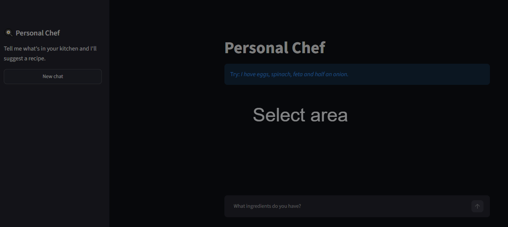

# 🍳 Personal Chef — Distributed AI & Cloud-Native Platform

An asynchronous, 4-tier AI cooking assistant built to demonstrate **Cloud-Native DevOps** (Docker, Kubernetes, GKE, GitHub Actions CI/CD) alongside **AI Engineering** (LangChain, Google Gemini, Tavily Search, LangSmith).

Tell the chef what ingredients you have at home, and it generates recipes, suggests substitutions for missing items, and persists your cooking history.



---

## 🏗️ System Architecture (4-Tier Asynchronous Design)

LLM calls and live web searches take **5–10 seconds**. Calling them synchronously inside a web server blocks HTTP threads and causes timeouts under load. 

To solve this, the application is decoupled into **4 microservices**:

```text
[ User Browser ]
       │
       ▼  (HTTP :8501)
┌──────────────────────┐
│ 1. Web Tier          │  ──► Stateless Streamlit UI. Dispatches jobs to Redis (<10ms)
│    (app.py)          │      and polls job status without blocking the web server.
└──────────┬───────────┘
           │  (LPUSH / GET)
           ▼
┌──────────────────────┐
│ 2. Message Broker    │  ──► Redis 7 (In-Memory Queue). Holds pending cooking tasks
│    (Redis)           │      and tracks real-time job state with 1-hour TTL.
└──────────┬───────────┘
           │  (BLPOP)
           ▼
┌──────────────────────┐
│ 3. AI Worker Tier    │  ──► Background Python worker. Consumes tasks from Redis,
│    (worker.py)       │      runs Gemini + Tavily agent, and writes results to DB.
└──────────┬───────────┘
           │  (SQL INSERT)
           ▼
┌──────────────────────┐
│ 4. Persistence Tier  │  ──► PostgreSQL 16. Relational schema (users 1:N recipes)
│    (PostgreSQL)      │      backed by persistent volume storage.
└──────────────────────┘
```

---

## 🛠️ Tech Stack

### 1. DevOps & Cloud Infrastructure (Primary Focus)
| Layer | Technology | Key Implementation Details |
|---|---|---|
| **Containerization** | Docker | Multi-stage build with `uv`, layer caching, non-root user (`appuser` UID 1000), native `/_stcore/health` check |
| **Local Orchestration** | Docker Compose | 4-container bridge network, `pg_isready` & `redis-cli ping` healthcheck dependency ordering, named volumes |
| **CI Pipeline** | GitHub Actions | Automated Docker build & push to GitHub Container Registry (`ghcr.io`) tagged with `:latest` and Git commit SHA |
| **Container Orchestration** | Kubernetes (K8s) | Modular manifests (`Deployment`, `Service`, `PersistentVolumeClaim`, `Secret`), Liveness & Readiness probes |
| **Cloud Platform** | Google Cloud (GKE) | Deployed on Google Kubernetes Engine with Cloud Load Balancer, Persistent Disk (`PGDATA` configured), and K8s Secrets |

### 2. AI & Application Engineering
| Layer | Technology | Purpose |
|---|---|---|
| **LLM** | Google Gemini (`gemini-2.5-flash`) | Recipe reasoning, ingredient matching, and dietary adherence |
| **Agent Framework** | LangChain & LangGraph | Tool-calling agent loop and conversation memory |
| **Live Web Search** | Tavily API | Verifies authentic cooking techniques, timings, and regional recipes |
| **Observability** | LangSmith | End-to-end tracing for prompts, tool calls, latency, and token usage |
| **Frontend & DB Driver** | Streamlit & `psycopg` (v3) | Interactive web interface and parameterized PostgreSQL queries |

---

## 📂 Project Structure

```text
├── .github/workflows/
│   └── ci.yml                   # GitHub Actions CI: builds & pushes image to ghcr.io
├── k8s/                         # Modular Kubernetes & GKE manifests
│   ├── postgres-pvc.yaml        # 1Gi ReadWriteOnce persistent storage claim
│   ├── postgres-deployment.yaml # PostgreSQL 16 pod with volume mounts & PGDATA
│   ├── postgres-service.yaml    # Internal ClusterIP service (db:5432)
│   ├── redis-deployment.yaml    # Redis 7 Alpine broker pod
│   ├── redis-service.yaml       # Internal ClusterIP service (redis:6379)
│   ├── worker-deployment.yaml   # Background AI worker consuming SecretRef
│   ├── web-deployment.yaml      # Streamlit web pod with Liveness/Readiness probes
│   └── web-service.yaml         # External LoadBalancer service (:8501)
├── agent.py                     # Core LangChain + Gemini + Tavily agent
├── app.py                       # Streamlit UI (Redis task producer + DB reader)
├── worker.py                    # Background worker (Redis BLPOP consumer + AI runner)
├── db.py                        # PostgreSQL relational schema & queries
├── Dockerfile                   # Production multi-stage Dockerfile
├── docker-compose.yml           # Local 4-tier container orchestration
└── pyproject.toml               # Python dependencies managed by uv
```

---

## 🚀 Getting Started

### Prerequisites
* API keys for [Google Gemini](https://aistudio.google.com/apikey), [Tavily](https://app.tavily.com), and [LangSmith](https://smith.langchain.com).
* Create a `.env` file in the project root:
  ```env
  GOOGLE_API_KEY=your-gemini-key
  TAVILY_API_KEY=your-tavily-key
  LANGSMITH_TRACING=true
  LANGSMITH_API_KEY=your-langsmith-key
  LANGSMITH_PROJECT=personal-chef
  ```

---

### Option 1: Run with Docker Compose (Recommended for Local Dev)

Starts all 4 containers (`personal-chef-app`, `personal-chef-worker`, `personal-chef-redis`, `personal-chef-db`) with health checks and persistent storage:

```bash
docker compose up --build
```
* Open **`http://localhost:8501`** in your browser.
* Stop containers cleanly (while preserving database volume):
  ```bash
  docker compose down
  ```

---

### Option 2: Run on Kubernetes (Local K8s or Google Cloud GKE)

1. **Create the Kubernetes Secret from your `.env` file:**
   ```bash
   kubectl create secret generic chef-secrets --from-env-file=.env
   ```
2. **Apply all manifests in `k8s/`:**
   ```bash
   kubectl apply -f k8s/
   ```
3. **Verify Pods and Service IP:**
   ```bash
   kubectl get pods
   kubectl get service chef-web-service
   ```
4. Access the app at **`http://localhost:8501`** (Docker Desktop K8s) or **`http://<EXTERNAL-IP>:8501`** (GKE LoadBalancer).

---

## 📈 Project Roadmap & Progress

### ✅ Completed Milestones
- [x] **Core AI Agent:** LangChain + Gemini + Tavily web search with LangSmith tracing
- [x] **Production Dockerization:** Multi-stage `uv` build, non-root security, layer caching, and container health checks
- [x] **4-Tier Distributed Architecture:** Decoupled Web UI, Redis task queue (`LPUSH`/`BLPOP`), Background AI Worker, and PostgreSQL relational database (`users` & `recipes`)
- [x] **Continuous Integration (CI):** GitHub Actions workflow auto-building and publishing images to GitHub Container Registry (`ghcr.io`)
- [x] **Kubernetes & Cloud Deployment:** Modular manifests deployed and tested on both local Kubernetes and **Google Kubernetes Engine (GKE)**

### 🔜 Planned Next Steps
- [ ] **GitOps Continuous Delivery (ArgoCD):** Declarative `argocd-app.yaml` watching the `k8s/` directory for automated cluster sync and drift self-healing
- [ ] **Infrastructure as Code (Terraform):** Provisioning Kubernetes/GKE infrastructure and namespaces reproducibly via Terraform
- [ ] **Horizontal Pod Autoscaling (HPA):** Auto-scaling `worker-deployment` replicas based on load
- [ ] **AI Enhancements:** Token-by-token streaming and LangSmith automated evaluation dataset
